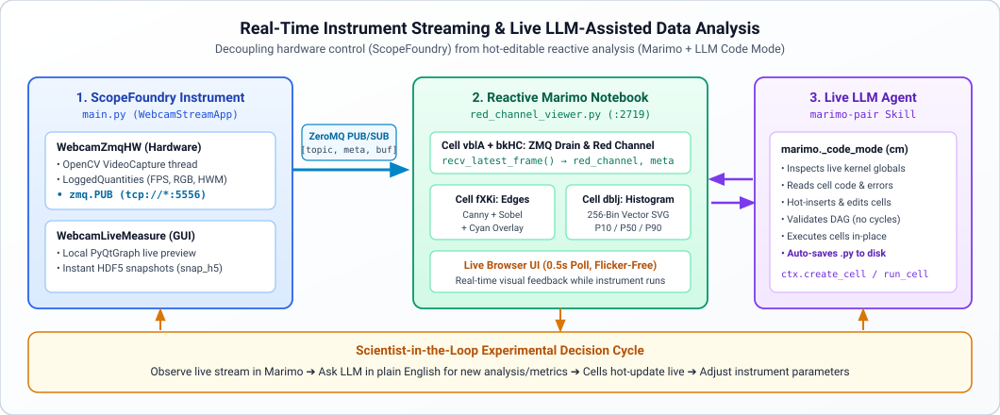
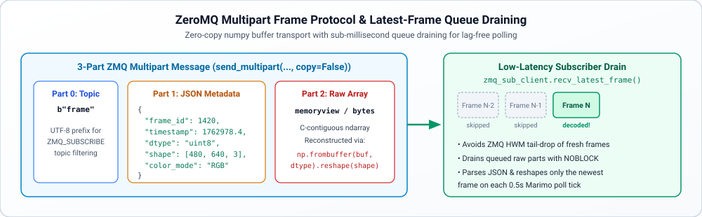
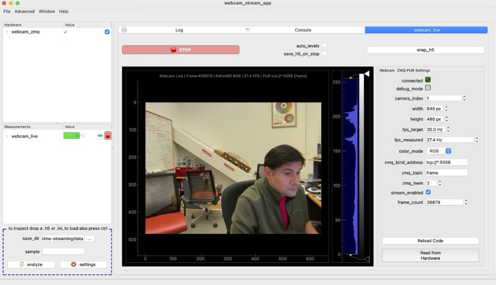
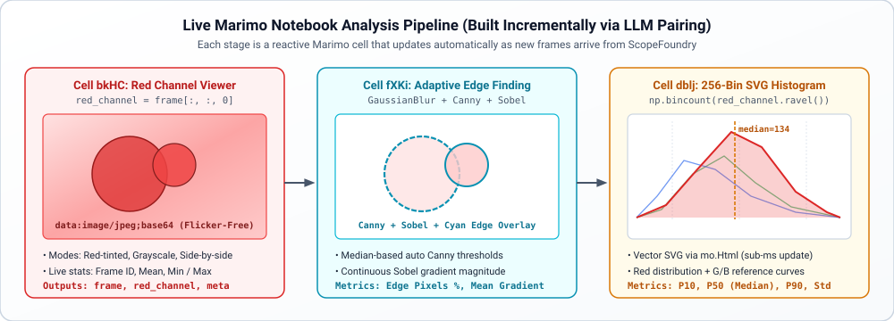
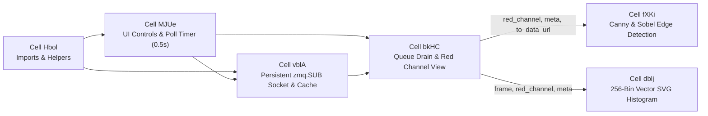
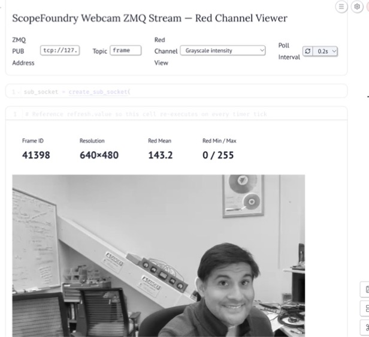
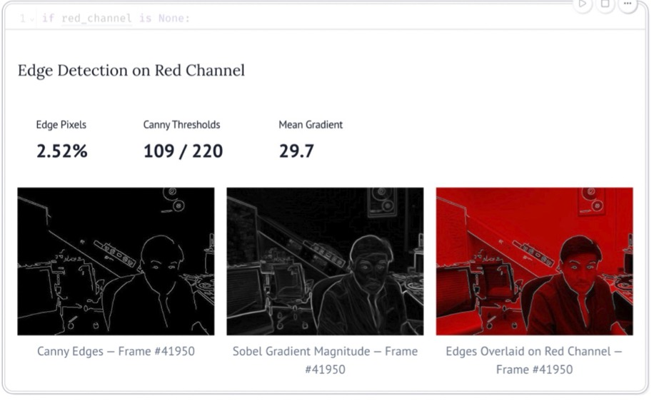
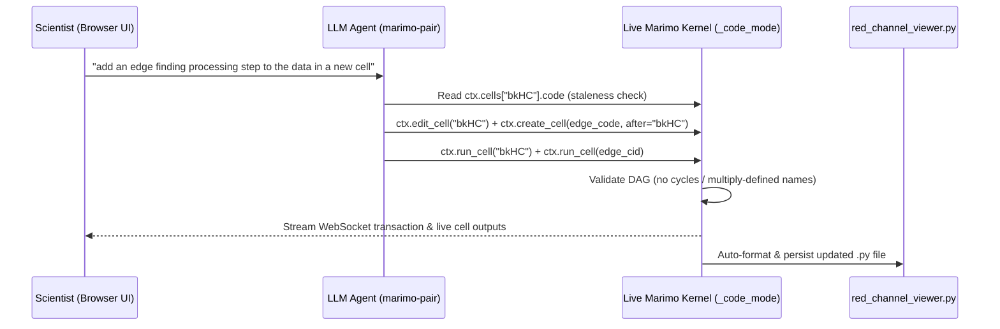

# ScopeFoundry → ZeroMQ → Marimo: Live Instrument Streaming & LLM-Assisted Analysis

A prototype demonstrating **real-time instrument data streaming** from a [ScopeFoundry](https://www.scopefoundry.org/) hardware application over **ZeroMQ (`PUB`/`SUB`)** into an interactive, reactive **[Marimo](https://marimo.io/) notebook**—where a user (and an LLM agent pairing live via `marimo._code_mode`) can build, modify, and tune live visualizations on the fly to make informed experimental decisions without interrupting data acquisition. This demo uses your webcam as stream of numerical data that you can analyze live.



---

## Why This Architecture?

During scientific experiments and microscopy runs, instrument control GUIs must remain rock-solid and responsive while researchers frequently want to explore **custom, experiment-specific metrics** (channel isolation, edge sharpness/focus metrics, exposure histograms, threshold overlays) on the live stream.

By decoupling acquisition from exploratory analysis:

1. **Uninterrupted Hardware Control (ScopeFoundry)**: [`WebcamStreamApp`](main.py) manages the hardware connection, background acquisition thread ([`WebcamZmqHW`](webcam_zmq_hw.py)), local PyQtGraph preview, and HDF5 snapshot archival ([`WebcamLiveMeasure`](webcam_live_measure.py)), while broadcasting every frame over a non-blocking ZeroMQ `PUB` socket.
2. **Reactive Live Visualization (Marimo)**: [`red_channel_viewer.py`](red_channel_viewer.py) subscribes to the ZMQ stream and models the analysis pipeline as a **Directed Acyclic Graph (DAG)** of reactive Python cells. Editing any downstream processing step immediately updates its visual output on the next incoming frame without restarting the camera or losing state.
3. **Live LLM Co-Pilot (`marimo-pair`)**: Because Marimo maintains a live Python kernel with a structured dataflow graph and programmatic code-mode API (`marimo._code_mode`), an LLM agent can inspect live variables, diagnose UI issues, and hot-insert new analysis cells directly into the running notebook while the user watches the stream update in real time.

> [!NOTE]
> **Beyond Webcams — Applicable to Any Live Scientific Data Stream**
> While this repository uses a standard webcam (`cv2.VideoCapture`) as a self-contained, zero-hardware-setup demo, the ZeroMQ multipart `[topic, metadata_json, raw_ndarray_bytes]` protocol transports arbitrary `numpy.ndarray` payloads and metadata. The exact same ScopeFoundry → ZeroMQ → Marimo + LLM workflow can be dropped into real laboratory instruments to stream and analyze:
> - **Microscopy & Scientific Imaging**: sCMOS/EMCCD fluorescence cameras, laser-scanning confocal frames, electron microscopy (SEM/TEM) feeds, or phase-contrast video.
> - **Optical Spectroscopy**: Live 1D/2D spectra from CCD/InGaAs spectrometers (Raman, photoluminescence, absorption/transmission, or streak cameras) for real-time peak fitting, background subtraction, and spectral integration.
> - **Hyperspectral & Scanning Probe Maps**: Point-by-point or line-by-line raster scan updates ( AFM, photocurrent, or lifetime mapping).
> - **Time-Series & Multi-Channel Detector Readouts**: Photon counter traces, lock-in amplifier channels, DAQ waveforms, or environmental sensor telemetry.

---

## End-to-End Dataflow & Wire Protocol



### 1. ScopeFoundry Publisher ([`webcam_zmq_hw.py`](webcam_zmq_hw.py))
When `webcam_zmq` is connected in ScopeFoundry, its background `threaded_update()` loop captures frames via OpenCV (`cv2.VideoCapture`), converts to the selected color space (`RGB`, `BGR`, or `GRAY`), and publishes a **3-part zero-copy multipart message** on `tcp://*:5556`:



```python
self.pub_socket.send_multipart(
    [topic_bytes, json.dumps(meta).encode("utf-8"), frame],
    flags=zmq.NOBLOCK,
    copy=False,
)
```

| Frame Part | Content | Example |
| :--- | :--- | :--- |
| **Part 0 (`topic`)** | UTF-8 subscription topic | `b"frame"` |
| **Part 1 (`meta`)** | JSON metadata header | `{"frame_id": 1420, "timestamp": 1762978.4, "dtype": "uint8", "shape": [480, 640, 3], "color_mode": "RGB"}` |
| **Part 2 (`frame`)** | Raw C-contiguous `numpy.ndarray` buffer | Zero-copy memory view reconstructed via `np.frombuffer(buf, dtype).reshape(shape)` |

### 2. Low-Latency Subscriber Drain ([`zmq_sub_client.py`](zmq_sub_client.py))
ZeroMQ `PUB`/`SUB` high-water marks (`HWM`) use **tail-drop**: if a small queue fills up between polls, ZeroMQ drops *newest* incoming frames while holding onto stale ones. To ensure that polling at a comfortable UI refresh rate (e.g., `0.5s`) always displays the **newest** camera frame:
- Both publisher (`zmq_hwm=60`) and subscriber (`rcvhwm=60`) allow a rolling window of frames.
- [`recv_latest_frame()`](zmq_sub_client.py) drains all queued multipart messages in a fast `zmq.NOBLOCK` loop (`copy=False`) and only decodes JSON + reshapes the `ndarray` for the **final (freshest)** message in the queue.

---

## Live Analysis Pipeline in Marimo ([`red_channel_viewer.py`](red_channel_viewer.py))





- **Cell `vblA` (Persistent Socket & Frame Cache)**: Holds the connected `zmq.SUB` socket and `frame_cache = {"latest": None}`. Because it only depends on `address_input` and `topic_input`, it stays open across all timer ticks.
- **Cell `bkHC` (Red Channel Extraction & Flicker-Free Rendering)**:
  - Triggered by `mo.ui.refresh` (`default_interval="0.5s"`).
  - Extracts `red_channel = frame[:, :, 0]` (for `RGB`) and encodes images as inline `data:image/jpeg;base64,...` URIs rather than raw bytes (avoiding Marimo's `/@file/...` virtual file HTTP round-trip that causes browser image flicker).
  - Supports **Red-tinted `(R, 0, 0)`**, **Grayscale intensity**, and **Side-by-side `(Original + Red)`** views.

  

- **Cell `fXKi` (Adaptive Edge Detection)**:
  - Smooths sensor noise with `cv2.GaussianBlur(red_channel, (5, 5), 1.2)`.
  - Computes automatic median-based Canny thresholds (`0.66 * median`, `1.33 * median`) alongside a continuous `cv2.Sobel` gradient magnitude map and a cyan edge overlay on the red channel.
  - Reports real-time **Edge Pixels %** and **Mean Gradient** (useful as live focus/alignment metrics).

  
- **Cell `dblj` (Live 256-Bin SVG Intensity Histogram)**:
  - Computes 8-bit pixel distributions via `np.bincount(red_channel.ravel(), minlength=256)` plus Green/Blue reference curves.
  - Renders directly as an inline vector `<svg>` via `mo.Html(...)` with **P10**, **Median (P50)**, **P90**, and **Std Dev** readouts—updating in sub-millisecond time with zero flicker.

---

## How LLM Live Pairing Works (`marimo-pair`)

During a live `marimo edit` session, the active kernel in memory—not the `.py` file on disk—is the source of truth. Using the [`marimo-pair`](.agents/skills/marimo-pair/SKILL.md) skill, an LLM agent connects directly to the running kernel's scratchpad endpoint (`execute-code.sh`) and uses `marimo._code_mode` (`cm`) to inspect and mutate the live notebook:



### Example Prompts Used to Build This Notebook Live
1. *"a scopefoundry app with a hardware component that captures webcam and streams out frames using zmq pub"* → Created [`webcam_zmq_hw.py`](webcam_zmq_hw.py), [`webcam_live_measure.py`](webcam_live_measure.py), [`zmq_sub_client.py`](zmq_sub_client.py), and [`main.py`](main.py).
2. *"now create a marimo notebook that subs that zmq topic and displays the red channel of the image"* → Created [`red_channel_viewer.py`](red_channel_viewer.py).
3. *"ok i just added a skill for marimo-pair so you can edit notebook live"* → Connected to the live kernel and fixed `mo.ui.refresh` interval validation.
4. *"why is image flickering?"* & *"there is some lag, can we just reduce refresh rate so less lag?"* → Switched to inline `data:image/jpeg;base64` URIs, added `frame_cache`, tuned polling to `0.5s`, and implemented fast zero-copy ZMQ queue draining.
5. *"add an edge finding processing step to the data in a new cell"* → Hot-inserted cell `fXKi` (Gaussian blur + adaptive Canny + Sobel gradient magnitude + cyan overlay).
6. *"create a cell showing histogram of data stream"* → Hot-inserted cell `dblj` (256-bin `np.bincount` inline SVG histogram with P10/P50/P90 metrics).

---

## Quickstart

### Prerequisites
This project uses [`uv`](https://docs.astral.sh/uv/) for Python environment and dependency management (`scopefoundry`, `marimo`, `pyzmq`, `opencv-python`, `pyqt6`, `pyqtgraph`, `numpy`).

```bash
uv sync
```

### Step 1: Start the ScopeFoundry Instrument App
```bash
uv run python main.py
```
- In the ScopeFoundry GUI, check **Connected** on `webcam_zmq` (or click **▶ START** in the `webcam_live` measurement tab).
- The webcam begins capturing and publishing multipart frames on `tcp://*:5556` (topic `frame`).

### Step 2: Launch the Interactive Marimo Notebook
In a second terminal:
```bash
# Launch in live edit mode (registers with marimo-pair discovery via --no-token)
uv run marimo edit red_channel_viewer.py --no-token
```
Or run as a clean dashboard web app:
```bash
uv run marimo run red_channel_viewer.py
```

### Step 3 (Optional): Test the Stream from the CLI
```bash
uv run python zmq_sub_client.py --address tcp://127.0.0.1:5556 --topic frame --count 10
```

---

## Repository Structure

| File | Description |
| :--- | :--- |
| [`main.py`](main.py) | ScopeFoundry `BaseMicroscopeApp` entry point (`WebcamStreamApp`) |
| [`webcam_zmq_hw.py`](webcam_zmq_hw.py) | `WebcamZmqHW(HardwareComponent)` — OpenCV capture + ZMQ `PUB` multipart streamer |
| [`webcam_live_measure.py`](webcam_live_measure.py) | `WebcamLiveMeasure(Measurement)` — In-app PyQtGraph live viewer & HDF5 snapshot saver |
| [`zmq_sub_client.py`](zmq_sub_client.py) | ZeroMQ `SUB` socket factory and low-latency queue-draining `recv_latest_frame()` helper |
| [`red_channel_viewer.py`](red_channel_viewer.py) | Reactive Marimo notebook: Red channel viewer, Canny/Sobel edge detector, and live SVG histogram |
| [`.agents/skills/marimo-pair/`](.agents/skills/marimo-pair/SKILL.md) | Skill enabling LLM agents to pair on a live Marimo kernel via `marimo._code_mode` |
| [`docs/images/`](docs/images/) | SVG architecture, wire-protocol, and pipeline figures embedded in this README |
| [`slides/`](slides/sf_marimo_slide_deck.md) | Presentation slide decks (`.md`, `.html`, `.pdf`, `.pptx`) summarizing the prototype |
