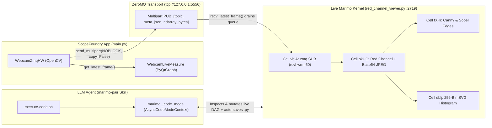
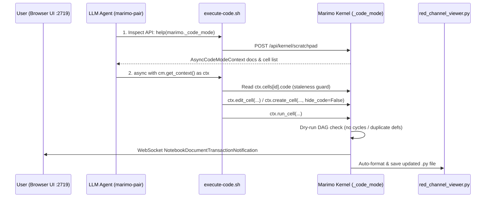

# Real-Time Instrument Streaming with ScopeFoundry, Marimo & Live LLM Pairing

## Slide 1: End-to-End Architecture



- **Decoupled Acquisition & Analysis**: [`WebcamStreamApp`](file:///Users/esbarnard/sf-marimo-streaming/main.py#L9-L19) handles hardware control and local HDF5 snapshots, while [`red_channel_viewer.py`](file:///Users/esbarnard/sf-marimo-streaming/red_channel_viewer.py) subscribes to the live stream without blocking the camera thread.
- **Hot-Swappable Visualizations**: The LLM connects directly to the active Marimo kernel via [`SKILL.md`](file:///Users/esbarnard/sf-marimo-streaming/.agents/skills/marimo-pair/SKILL.md) to add and refine analysis cells while frames are streaming.

<!-- slide -->

## Slide 2: ScopeFoundry Data Streaming (`WebcamZmqHW`)

### Hardware Component ([`webcam_zmq_hw.py`](file:///Users/esbarnard/sf-marimo-streaming/webcam_zmq_hw.py))
- Subclasses `ScopeFoundry.HardwareComponent` ([`WebcamZmqHW`](file:///Users/esbarnard/sf-marimo-streaming/webcam_zmq_hw.py#L12-L216)):
  - **`setup()`**: Defines `LoggedQuantity` settings (`camera_index`, `width`, `height`, `fps_target`, `fps_measured`, `color_mode`, `zmq_bind_address`, `zmq_topic`, `zmq_hwm=60`, `stream_enabled`, `frame_count`).
  - **`connect()`**: Opens `cv2.VideoCapture` and binds a `zmq.PUB` socket (`tcp://*:5556`, `SNDHWM=60`, `LINGER=0`).
  - **`threaded_update()`**: Automatically runs in ScopeFoundry's background hardware thread while connected; captures frames, converts color (`RGB`/`BGR`/`GRAY`), updates smoothed FPS, and publishes a 3-part zero-copy ZMQ message:

```python
self.pub_socket.send_multipart(
    [topic_bytes, json.dumps(meta).encode("utf-8"), frame],
    flags=zmq.NOBLOCK,
    copy=False,
)
```

### In-App Live Viewer ([`webcam_live_measure.py`](file:///Users/esbarnard/sf-marimo-streaming/webcam_live_measure.py))
- [`WebcamLiveMeasure`](file:///Users/esbarnard/sf-marimo-streaming/webcam_live_measure.py#L9-L133) displays the live camera feed in PyQtGraph (`ImageItem` + `HistogramLUTItem`) alongside hardware controls and a [`snap_h5`](file:///Users/esbarnard/sf-marimo-streaming/webcam_live_measure.py#L98-L107) operation for saving HDF5 snapshots.

<!-- slide -->

## Slide 3: Marimo Notebook Receiving Data (`red_channel_viewer.py`)

### Reactive Dataflow DAG
1. **Imports (`Hbol`)**: Loads `base64`, `cv2`, `marimo`, `numpy`, and [`zmq_sub_client.py`](file:///Users/esbarnard/sf-marimo-streaming/zmq_sub_client.py).
2. **UI Controls (`MJUe`)**: Defines `address_input`, `topic_input`, `display_mode`, and `refresh = mo.ui.refresh(options=["0.2s", "0.5s", "1s", "2s", "5s"], default_interval="0.5s")`.
3. **Persistent Socket & Cache (`vblA`)**: Creates `sub_socket` ([`create_sub_socket`](file:///Users/esbarnard/sf-marimo-streaming/zmq_sub_client.py#L9-L23)) and `frame_cache = {"latest": None}`. Only re-runs if the address or topic changes.
4. **Frame Polling & Red Channel View (`bkHC`)**: Triggered by `refresh.value`; calls [`recv_latest_frame`](file:///Users/esbarnard/sf-marimo-streaming/zmq_sub_client.py#L45-L63), extracts `red_channel`, and exposes `(frame, red_channel, meta, to_data_url)` to downstream cells.

### Engineering Smooth Live Streaming in Marimo
- **Eliminating Image Flicker**:
  - Passing raw `bytes` to `mo.image()` creates a new `/@file/...` virtual URL on every tick, causing a secondary browser HTTP request and momentary blank frame.
  - Encoding frames as inline `data:image/jpeg;base64,...` strings and caching `frame_cache["latest"]` across ticks eliminates both HTTP round-trip flicker and empty-poll warning flashes.
- **Eliminating ZMQ Queue Lag**:
  - ZeroMQ `PUB/SUB` high-water marks (`HWM`) use *tail-drop* (dropping **new** messages once the queue fills with old ones).
  - Setting `rcvhwm=60` and draining all queued raw multipart buffers with `recv_multipart(flags=zmq.NOBLOCK, copy=False)` before decoding only the final message guarantees every `0.5s` refresh renders the newest camera frame.

<!-- slide -->

## Slide 4: LLM Connection to Marimo via `marimo-pair` Skill



> [!IMPORTANT]
> **Active Runtime Is the Source of Truth**: During a live `marimo edit` session, editing the `.py` file on disk directly is ignored by the running kernel and overwritten on save. All structural and code changes go through `marimo._code_mode` (`cm`).

<!-- slide -->

## Slide 5: Conversational Prompts Used to Build Live Visualizations

| Stage | User Prompt | Agent Action & Live Result |
| :--- | :--- | :--- |
| **1. Instrument & Stream Setup** | *"a scopefoundry app with a hardware component that captures webcam and streams out frames using zmq pub"* | Clarified multipart format & live viewer tab; created [`webcam_zmq_hw.py`](file:///Users/esbarnard/sf-marimo-streaming/webcam_zmq_hw.py), [`webcam_live_measure.py`](file:///Users/esbarnard/sf-marimo-streaming/webcam_live_measure.py), [`zmq_sub_client.py`](file:///Users/esbarnard/sf-marimo-streaming/zmq_sub_client.py), and [`main.py`](file:///Users/esbarnard/sf-marimo-streaming/main.py). |
| **2. Initial Subscriber Notebook** | *"now create a marimo notebook that subs that zmq topic and displays the red channel of the image"* | Created [`red_channel_viewer.py`](file:///Users/esbarnard/sf-marimo-streaming/red_channel_viewer.py) with persistent `zmq.SUB` cell, `mo.ui.refresh`, and Red-tinted / Grayscale / Side-by-side views. |
| **3. Live Pairing & Widget Fix** | *"ok i just added a skill for marimo-pair so you can edit notebook live"* + *"options.0: Must be greater than 0.1 seconds"* | Launched `marimo edit --no-token` on `:2719`, ran `help(cm)`, and live-edited cell `MJUe` via `cm.get_context()` to remove `"0.05s"`. |
| **4. Visual & Latency Tuning** | *"why is image flickering?"* & *"there is some lag, can we just reduce refresh rate so less lag?"* | Replaced virtual file URLs with inline `data:image/jpeg;base64` URIs, added `frame_cache`, set poll interval to `0.5s`, and added fast zero-copy ZMQ queue draining. |
| **5. Live Feature: Edge Detection** | *"add an edge finding processing step to the data in a new cell"* | Hot-inserted cell `fXKi` ([lines 182–252](file:///Users/esbarnard/sf-marimo-streaming/red_channel_viewer.py#L182-L252)): Gaussian blur, adaptive Canny edges, Sobel gradient magnitude, and cyan edge overlay on the red channel. |
| **6. Live Feature: Stream Histogram** | *"create a cell showing histogram of data stream"* | Hot-inserted cell `dblj`: 256-bin `np.bincount` pixel distribution rendered as a flicker-free inline `<svg>` chart with P10/Median/P90 stats and G/B reference curves. |

